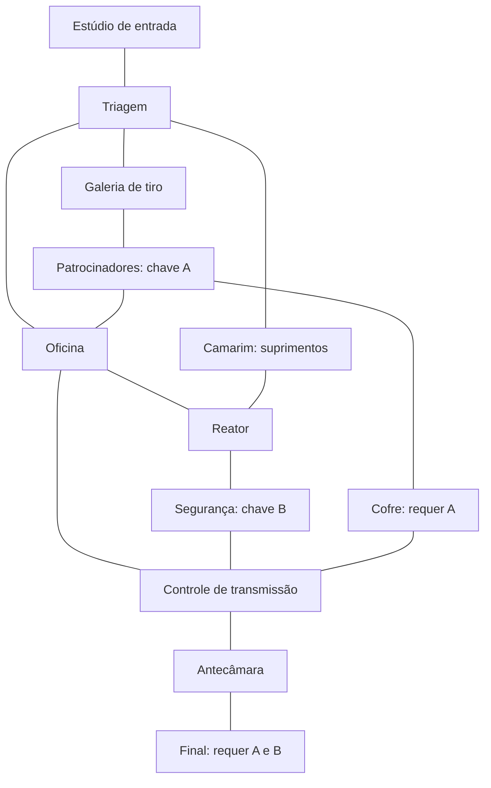

# King of the Kill

Jogo de ação 2D com mira independente do movimento (*twin-stick shooter*), desenvolvido em Unity para estudar programação, combate e construção de arenas. O jogador participa de uma competição mortal transmitida como um programa de televisão: precisa sobreviver, explorar os setores do estúdio e conquistar acesso à grande final.

**Estado:** protótipo em desenvolvimento. **Plataforma prevista:** navegador, via itch.io. **Resolução de referência:** 640 × 480.

<!-- Personalize a introdução e acrescente screenshots quando tiver capturas do jogo. -->

- Jogar no itch.io: **[adicionar link]**
- Nome completo do aluno: **[PREENCHER NOME COMPLETO]**
- Repositório: **[PREENCHER URL DO REPOSITÓRIO]**
- Contexto acadêmico: **[preencher, se desejar]**

## Como jogar

Elimine todos os inimigos da sala para abrir as portas. Escolha o próximo caminho, recolha munição e procure as credenciais **A** e **B**. As duas são necessárias para entrar na arena do **Executor da Audiência**. Derrotar o chefe e seus acompanhantes encerra a partida em vitória.

O jogador tem três pontos de vida. A partida termina quando a vida chega a zero ou quando acaba o prazo de uma sala em combate. O cronômetro de combate para depois da limpeza; explorar salas já concluídas não consome esse prazo.

| Ação | Teclado e mouse | Controle |
|---|---|---|
| Mover | WASD ou setas | Analógico esquerdo |
| Mirar | Mouse sobre a arena | Analógico direito |
| Atirar | Segurar o botão esquerdo | Segurar o gatilho direito |
| Pausar / retornar | Esc | Start (Menu) |
| Cancelar confirmação de reinício | Esc ou Cancelar | B ou Cancelar |
| Trocar de sala | Entrar em uma porta aberta | Entrar em uma porta aberta |
| Navegar nos menus | Mouse ou teclado | Direcional/analógico e confirmação |

## Mecânicas

- Doze arenas conectadas, com cinco inimigos em cada primeiro combate: sessenta no circuito completo, incluindo o chefe. Caminhos alternativos e salas opcionais.
- Portas bloqueadas durante o combate e acessos que exigem credenciais.
- Minimapa com conexões reais, sala atual, salas concluídas e acessos bloqueados.
- Soldados lentos, robôs rápidos e hitmen estacionários com rajadas.
- Variantes resistentes e chefe que intensifica os ataques ao perder metade da vida.
- Coberturas que bloqueiam tiros e perseguidores que contornam obstáculos.
- Pontos por derrotar inimigos, recolher dinheiro, joias e credenciais.
- Invulnerabilidade breve com piscadas após receber dano.
- Derrota por vida ou tempo, explosões e resultado após o som de morte.
- Menu, história, instruções, confirmação visual e transições.
- Pausa com Start/Esc, retorno e reinício com confirmação; congela combate, prazo e áudio.
- Balas com sprites direcionais e mira do controle com zona morta única e suavização angular.
- Chefe com explosão maior e prolongada, aplausos e espera antes do painel de vitória.

Munição e cura não concedem pontos. A cura recupera uma vida e fica no chão se a vida já estiver cheia. Cada pacote de munição entrega oito tiros; a partida começa com vinte. Quando restam até dois tiros e não há pacote alcançável, o jogo procura um ponto livre no campo de navegação para repor munição. Se estiver sem tiros e a reposição física continuar impossível por cerca de dois segundos, recebe três tiros de emergência, sem pontos. O prazo do combate continua correndo.

Os cinco inimigos da final são o chefe e quatro acompanhantes. Os pacotes de cada sala fornecem pelo menos 50% de tiros extras em relação à vida total dos inimigos, sem contar munição trazida de outra sala nem reposição de emergência. Isso reduz o risco de esgotar os recursos; não garante vitória nem dispensa mirar e esquivar.

As salas preservam seu estado durante a partida: voltar não recria inimigos nem recompensas coletadas. Cada sala concluída aumenta em 5% a velocidade de movimento dos próximos inimigos, até o limite de 25%.

## Circuito

O circuito é fixo. As salas são montadas em tempo de execução a partir dos assets de configuração; não há uma cena Unity separada para cada sala.

| Sala | Proposta | Inimigos | Munição no chão | Prazo |
|---|---|---:|---:|---:|
| Estúdio de entrada | Introdução ao circuito | 5 | 8 tiros | 35 s |
| Triagem dos competidores | Escolha entre três rotas | 5 | 16 tiros | 38 s |
| Galeria de tiro | Cobertura contra atiradores | 5 | 16 tiros | 40 s |
| Ala dos patrocinadores | Credencial A | 5 | 16 tiros | 45 s |
| Oficina de execução | Robôs rápidos entre corredores | 5 | 24 tiros | 42 s |
| Reator de audiência | Perseguidores resistentes e rotas alternativas | 5 | 24 tiros | 45 s |
| Central de segurança | Credencial B | 5 | 24 tiros | 48 s |
| Controle de transmissão | Combate misto e acesso à reta final | 5 | 24 tiros | 46 s |
| Camarim de emergência | Rota opcional com cura e munição | 5 | 16 tiros | 32 s |
| Cofre da audiência | Desafio opcional por pontos; exige A | 5 | 24 tiros | 50 s |
| Antecâmara da final | Último combate e reabastecimento | 5 | 24 tiros | 45 s |
| Final da transmissão | Chefe e acompanhantes; exige A e B | 5 | 48 tiros | 70 s |

No minimapa, amarelo indica a sala atual, verde uma sala concluída e marrom um acesso bloqueado por credenciais. **A**, **B**, **$**, **+** e **F** identificam credenciais, cofre, camarim e final. Nas portas, verde significa passagem aberta, vermelho combate e amarelo requisito pendente.

## Abrir o projeto

1. Instale o Unity Hub e o **Unity 6000.4.4f1**, versão de `ProjectSettings/ProjectVersion.txt`.
2. Para exportar ao navegador, instale também **Web Build Support** dessa versão.
3. Clone o repositório ou extraia o projeto em uma pasta nova.
4. No Unity Hub, adicione a pasta que contém `Assets`, `Packages` e `ProjectSettings`.
5. Aguarde a importação dos assets e a resolução dos pacotes.
6. Abra `Assets/Scenes/MainMenu.unity` e pressione **Play**.

A configuração de Git fornecida no projeto usa **Git LFS** para imagens e áudios. Instale [Git LFS](https://git-lfs.com/) e execute `git lfs install` antes de clonar ou enviar o repositório. Preserve Assets, Packages, ProjectSettings e os arquivos .meta; caches do Editor não precisam ser versionados.

O projeto usa C#, URP 2D **17.4.0**, Input System **1.19.0** e uGUI **2.0.0**. As dependências completas estão em `Packages/manifest.json` e `Packages/packages-lock.json`.

Prefira abrir esta atualização em uma pasta separada. Misturar arquivos antigos pode deixar simultaneamente `Projectiles.cs` e `Projectile.cs`, que declaram a mesma classe. Esta versão contém somente `Projectile.cs`; conserve os arquivos `.meta` junto dos assets.

## Estrutura e edição

| Caminho | Conteúdo |
|---|---|
| `Assets/Scenes/MainMenu.unity` | Menu, história e instruções |
| `Assets/Scenes/Arena01Estudio.unity` | Cena que hospeda todo o circuito |
| `Assets/Data/Arenas/` | Configurações das doze salas |
| `Assets/Prefabs/` | Jogador, inimigos, projéteis e itens |
| `Assets/Scripts/` | Lógica do jogo e da interface |
| `Assets/Editor/ProjectValidation.cs` | Verificação pelo menu do Editor |
| `Assets/Art/` | Sprites, interface e efeitos visuais |
| `Assets/Audio/KenneyFeedback/` | Novos sons curtos e licenças |
| `CREDITOS.txt` | Origens e créditos detalhados |
| `Tests/validate_five_enemy_layouts.py` | Auditoria geométrica e de recursos, fora do Unity |

Para editar uma arena, selecione seu asset em `Assets/Data/Arenas/`: nome, anúncio, prazo, cores, posições, inimigos, itens, coberturas e portas são configuráveis. `mapPosition` define a coordenada no minimapa e `mapLabel` a sigla. Cada porta deve apontar para uma sala vizinha com porta de retorno; inclua novas salas na lista `Arenas` do `WaveManager` da cena.

Vida, velocidade, pontos e rajadas ficam nos prefabs dos inimigos. Sons de coleta ficam no componente `Pickup`; o som de sala concluída fica no `WaveManager`. O `MenuActions` aceita uma gravação existente em `Title Voice` e um atraso mínimo em `Title Delay`. Nenhuma narração é fornecida.

## Ajustes de mira, pausa e final

No Xbox, mantenha o polegar direito no analógico e use **RT para atirar**. A mira agora usa uma zona morta radial única de **0,12**, em vez de somar outro limiar ao processamento padrão. Movimentos leves têm suavização maior; inclinação completa responde mais rápido. Ao soltar, a direção permanece. O mouse continua apontando diretamente para o cursor.

No prefab `Player`, o `PlayerShooter` expõe **Stick Deadzone**, **Fine Aim Response** (18) e **Full Aim Response** (45). Valores maiores de resposta reduzem a suavização. Se um controle apresentar drift, aumente a zona morta gradualmente para 0,15. Essa sensação precisa ser avaliada com seu controle no build Web; não foi testada em hardware nesta revisão.

**Start/Esc** abre a pausa. **Retornar** continua a mesma partida. **Reiniciar** abre uma confirmação, selecionando **Cancelar** inicialmente. **Sim, reiniciar** volta à primeira sala e zera progresso. B/Esc/Start fecha a confirmação e volta às opções; fora da confirmação, retorna ao jogo. Use direcional/analógico esquerdo e A/Enter, ou mouse. O jogo não aceita pausa durante transições nem após o resultado. Depois de retornar, solte o comando de tiro antes de disparar novamente.

A pausa mantém as posições dos projéteis, a fase das rajadas, o tempo restante e a posição da música. O botão de confirmação continua audível. O painel é criado pelo `PauseMenu`, já conectado ao Canvas da arena, em referência 640 × 480. O menu principal e seu texto de história foram preservados sem alterar a cena nesta revisão.

As balas reutilizam os PNGs do **Shooting Gallery**, do Kenney: douradas para o jogador e prateadas tingidas de vermelho para inimigos. A imagem gira com o disparo. Raios de colisão, dano, velocidade e cadência permanecem iguais.

O `BossExecutor` usa **Boss Explosion Scale = 3** e **Boss Explosion Duration = 3**: o efeito tem o dobro do diâmetro da versão anterior e a animação dura aproximadamente 3,1 s. Os aplausos existentes duram cerca de 7,65 s. A tela de vitória espera a animação e o áudio terminarem. Ainda é necessário derrotar os quatro acompanhantes; matar o chefe sozinho não encerra a sala.

### Prévia do Inspector

O stack trace relatado aponta a `UnityEditor.ObjectPreview.DrawPreview`, sem linha de script do jogo. Isso indica uma referência de prévia do Editor a uma `Image` destruída; não confirma uma falha do build.

Foram adicionadas verificações de referências de UI e recuperação da imagem de transição. O script de Editor limpa a seleção de uma Image de cena ao sair do Play Mode. Se o erro persistir, saia do Play, **destrave o cadeado do Inspector** e execute **King of the Kill → Limpar seleção e prévia do Inspector**. Se necessário, feche e reabra a aba Inspector. Esse comando não edita cenas e não oculta erros do Console. A reprodução e a resolução definitiva da exceção do Editor ainda precisam ser confirmadas na instalação Unity usada pelo autor.

## Novos sons

Os sons curtos são arquivos existentes do Kenney; os aplausos são da Blender Foundation, com recorte de LeeZH. Todos foram copiados sem editar o áudio ou gerar sons. Os créditos saíram da interface e permanecem no repositório, também disponíveis para a página do itch.io.

| Evento | Arquivo no projeto | Original | Duração aproximada |
|---|---|---|---:|
| Credencial e tesouros | `KeyPickup.ogg` | `confirmation_001.ogg` — Interface Sounds | 0,29 s |
| Sala concluída | `RoomClear.ogg` | `confirmation_004.ogg` — Interface Sounds | 0,49 s |
| Kit de cura | `HealthPickup.ogg` | `powerUp7.ogg` — Digital Audio | 0,52 s |
| Chefe derrotado | `BlenderFoundation/BossApplause.wav` | `applause.wav` — Blender Foundation / LeeZH | 7,65 s |

## Exportar para itch.io

1. Em **File → Build Profiles**, selecione **Web**.
2. Mantenha `MainMenu` e `Arena01Estudio`, nessa ordem, na lista de cenas do perfil ativo.
3. Confira a referência de **640 × 480**. O projeto usa **Gzip** e **Decompression Fallback**.
4. Use **Build and Run** e teste no servidor local aberto pelo Unity.
5. Compacte o conteúdo da pasta de build em um **ZIP**, com `index.html` na raiz.
6. No itch.io, escolha um projeto HTML, envie esse ZIP e configure a área para 640 × 480.
7. Teste áudio após a primeira interação, mira, controle, troca de salas, derrota, vitória e reinício no navegador.

O projeto-fonte não é o build para upload. Consulte [jogos HTML5 no itch.io](https://itch.io/docs/creators/html5) e [distribuição Web no Unity](https://docs.unity3d.com/6000.4/Documentation/Manual/webgl-deploying.html).

## Página do itch.io e critérios da avaliação

Os quatro itens devem aparecer na página publicada. Campos entre colchetes são pendências, não dados prontos para publicação.

| Critério | Onde preencher | Verificação |
|---|---|---|
| Imagem de capa | **Edit game → Cover image** | A miniatura do projeto mostra o jogo e o título |
| Descrição | **Short description** e descrição principal | Explica proposta, objetivo e controles |
| Nome do aluno | Na descrição principal, perto do início | Nome completo visível; não depender apenas do apelido da conta |
| Link do repositório | Na descrição principal | Link clicável para este projeto; abre para o avaliador |

**Descrição curta sugerida:** Sobreviva a uma competição mortal de TV: explore arenas, reúna credenciais e enfrente o chefe em um shooter 2D com mira independente.

**Texto-base para a descrição principal** — substitua os dois campos antes de publicar:

> **King of the Kill** é um jogo de ação 2D com mira independente do movimento, ambientado em uma competição mortal transmitida pela televisão.
>
> Elimine os inimigos antes que o tempo acabe, abra as portas e explore doze arenas conectadas. Enfrente soldados, robôs e hitmen, recolha munição e cura e reúna as credenciais A e B para chegar à grande final. Dinheiro e joias aumentam sua pontuação, mas o jogador só tem três pontos de vida.
>
> **Controles:** WASD ou setas para mover, mouse para mirar e botão esquerdo para atirar. No controle, use o analógico esquerdo para mover, o direito para mirar e o gatilho direito para atirar.
>
> **Aluno e desenvolvedor:** [PREENCHER NOME COMPLETO].
>
> **Código-fonte e documentação:** [PREENCHER URL DO REPOSITÓRIO].
>
> Projeto acadêmico desenvolvido em Unity. Versão para navegador de computador.

No editor de texto do itch.io, selecione “Código-fonte e documentação”, clique no botão de link e insira a URL real. Inclua abaixo os créditos de assets deste README e de `CREDITOS.txt`, depois de completar as entradas ainda pendentes.

### Capa com os assets existentes

1. Rode a versão final do jogo e capture uma imagem real do menu ou de uma arena, sem janelas do Editor, mensagens de erro ou cursor cobrindo o título.
2. Prepare uma imagem **630 × 500 px**, mantendo a proporção dos sprites e da captura. Essa proporção é recomendada pelo itch.io; a resolução da capa é independente dos 640 × 480 do jogo.
3. Use o título **KING OF THE KILL** em tamanho legível na miniatura. Aproveite os personagens e a identidade visual já presentes; evite uma imagem que prometa conteúdo ausente do jogo.
4. Exporte PNG/JPG e envie em **Cover image**. A imagem de fundo da página e o fundo do menu dentro do jogo não preenchem esse campo.
5. Acrescente de três a cinco capturas reais: combate, outra arena e encontro com o chefe, por exemplo. Preserve os créditos dos assets utilizados.

Nenhuma nova imagem ou áudio foi gerado nesta revisão. A capa ainda precisa ser preparada a partir de uma captura do jogo em execução.

### Conferência da página publicada

- [ ] Capa enviada no campo correto e legível em miniatura.
- [ ] Descrição curta e principal preenchidas, sem campos entre colchetes.
- [ ] Nome completo do aluno visível na própria página.
- [ ] Link do repositório correto e acessível ao avaliador.
- [ ] Créditos externos completos.
- [ ] Build **Web em ZIP**, com `index.html` na raiz, selecionado para jogar no navegador.
- [ ] Área de jogo em **640 × 480**, com início por clique para permitir a interação inicial com áudio.
- [ ] Página, link do repositório e partida conferidos em uma janela anônima.

Fontes: [primeira página no itch.io](https://itch.io/docs/creators/getting-started), [envio de jogos HTML5](https://itch.io/docs/creators/html5).

## Tratamento de dead-end e softlock

Um beco sem saída opcional com porta de retorno não é, por si só, um softlock. A derrota normal pelo prazo também encerra a partida: o problema seria perder a possibilidade de avançar **e** de chegar a um encerramento/reinício válido por falha do jogo.

- **Mapa:** as quinze conexões são bidirecionais. As credenciais não dependem uma da outra; ambas podem ser obtidas antes da final.
- **Revisita:** salas limpas conservam os itens não recolhidos e não reiniciam o combate. É possível sair sem a credencial e voltar para buscá-la.
- **Credencial perdida:** a sala concluída recoloca uma recompensa ausente ou inacessível. Se o prefab/espaço impedir isso, entrega a credencial diretamente, sem pontuação de coleta.
- **Munição:** a reposição consulta posições conectadas ao jogador, com uma reserva de emergência quando não existe pacote alcançável nem posição disponível. O tempo continua sendo um risco legítimo.
- **Transição:** erros no comando de troca são registrados no Console e a sobreposição deixa de bloquear a interface. A conclusão/cancelamento libera os controles e permite tentar novamente. Essa proteção não repara automaticamente uma cena ou prefab configurado incorretamente.
- **Encerramento:** morte, tempo esgotado e vitória usam os botões de reinício/retorno; devem ser testados no Editor e no build.

A auditoria geométrica e de progressão encontrou **43 estados alcançáveis de sala/credenciais, todos com caminho para a vitória**, e verificou oito casos de sair de uma sala de credencial e voltar sem tê-la coletado. A análise presume que cada combate possa ser vencido; não mede habilidade exigida, dificuldade dos prazos ou estabilidade da simulação física.

## Verificação e próximos passos

Esta revisão passou por verificações estáticas de sintaxe C#, referências, portas, requisitos de credenciais, posições acessíveis e duração dos novos sons. **Não foi compilada nem executada no Unity Editor neste ambiente; o build Web também não foi produzido.** O balanceamento precisa ser avaliado em uma partida real.

Fora do Play Mode, use **King of the Kill → Validar projeto**. Depois, teste as duas ordens de coleta das credenciais, o cofre bloqueado, a revisita a salas limpas, a cura com vida cheia, a reposição de munição e o reinício após morte/tempo/vitória. Veja também `VALIDACAO.txt`, que inclui o roteiro de testes das proteções contra softlock.

A revisão de cinco inimigos verificou 31 situações de entrada, incluindo o início da partida. Na análise geométrica, todos os inimigos ficam imóveis e são tratados como obstáculos; mesmo assim, os pacotes de munição e posições de tiro continuam alcançáveis. Foi corrigido um soldado que sobrepunha a área de chegada norte do Controle de transmissão. Os limites de tempo foram mantidos: as rotas simplificadas cabem nos prazos, mas esquiva, dano e dificuldade real ainda precisam de Play Mode.

Para reproduzir essa análise separada, instale **Python 3 e PyYAML** e execute, na raiz do projeto, `python Tests/validate_five_enemy_layouts.py`. Ela não executa C# nem substitui o teste no Unity. O menu **King of the Kill → Validar projeto** também passa a rejeitar salas com menos de cinco inimigos, verificar a margem de munição e testar a contagem de cinco eliminações; essa validação do Editor não foi executada neste ambiente.

- [ ] Ajustar dificuldade e prazos após testes de jogo.
- [ ] Inserir uma gravação de anúncio do título.
- [ ] Acrescentar screenshots e o link do itch.io.
- [ ] Completar os créditos dos assets do projeto original.
- [ ] Definir a licença do código e as regras de contribuição.

## Créditos e licenças

| Uso | Autor / pacote | Licença / referência |
|---|---|---|
| Personagens, pisos, portas, coberturas e joias | Kenney — Top-down Shooter | [CC0 / fonte](https://kenney.nl/assets/top-down-shooter) |
| Interface | Kenney — UI Pack: Sci-Fi | [CC0 / fonte](https://kenney.nl/assets/ui-pack-sci-fi) |
| Ícones de entrada | Kenney — Input Prompts | [CC0 / fonte](https://kenney.nl/assets/input-prompts) |
| Chaves e dinheiro | Kenney — Generic Items | [CC0 / fonte](https://opengameart.org/content/generic-items) |
| Chave, tesouros e sala concluída | Kenney — Interface Sounds | [CC0 / fonte](https://kenney.nl/assets/interface-sounds) |
| Cura | Kenney — Digital Audio | [CC0 / fonte](https://kenney.nl/assets/digital-audio) |
| Confirmação de menu e munição | Joth — 7 Assorted Sound Effects | [CC0 / fonte](https://opengameart.org/content/7-assorted-sound-effects-menu-level-up) |
| Fundo do menu | hassekf / Ask4Asset — Sci-Fi Background | [CC0 / fonte](https://opengameart.org/content/sci-fi-background) |
| Fonte Liberation Sans | Autores indicados no OFL incluído | `Assets/TextMesh Pro/Fonts/LiberationSans - OFL.txt` |

Músicas, sons de morte e alguns sprites de itens/efeitos foram preservados do projeto original. Sua documentação de autoria e licença ainda deve ser completada; a licença CC0 dos pacotes acima não se estende a esses arquivos. Consulte a lista em [CREDITOS.txt](CREDITOS.txt).

**Licença do código:** a definir pelo autor. Os assets de terceiros seguem suas respectivas licenças, mantidas nas pastas de origem.

## Créditos acrescentados nesta revisão

- **Sprites de balas:** Kenney — [Shooting Gallery](https://kenney.nl/assets/shooting-gallery), [CC0](https://creativecommons.org/publicdomain/zero/1.0/). PNGs originais, sem alterar pixels; escala, rotação e cor configuradas na Unity.
- **Aplausos:** Blender Foundation — Yo Frankie!, recorte por LeeZH, [Applause](https://opengameart.org/content/applause), [CC BY 3.0](https://creativecommons.org/licenses/by/3.0/). WAV copiado sem edição. Inclua este crédito também na página itch.io.

Nenhuma imagem ou som foi gerado nesta revisão. As licenças e fontes detalhadas ficam em `CREDITOS.txt` e junto dos assets.
